# Student 4 - Release 2 screenshots

Taken 2026-10-27 23:26 on the dev PC (Ollama llama3.2, RAG, MCP and Multi-Agent servers, Student 4 app).

## 01-local-services-running
Local deployment: Ollama, RAG (6002), MCP (6003) and Multi-Agent (6004) run on the PC outside Docker; Student 4 app on 5004

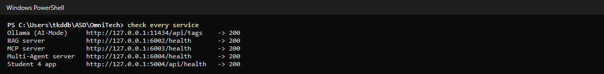

## 02-multi-agent-health
Multi-Agent server /health: port 6004, llama3.2, Ollama reachable, agents and human decisions

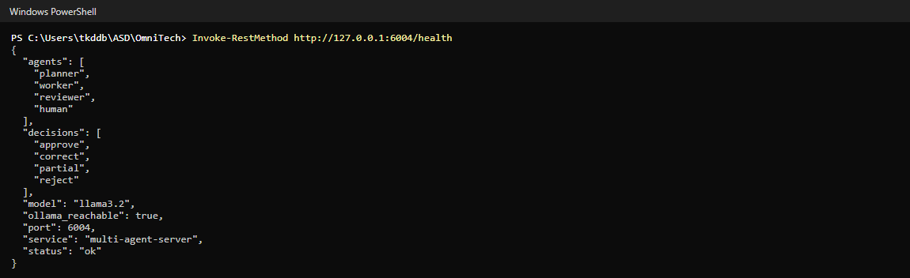

## 03-app-health-ai-on
Student 4 /api/health with every AI feature switched on (local)

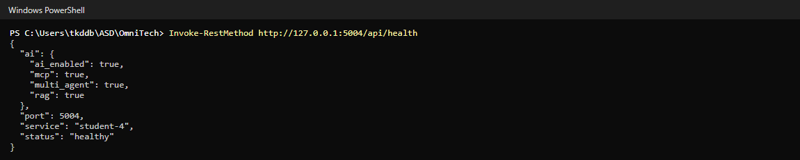

## 04-page-overview
Student 4 page with the new Cart review (Multi-Agent) card

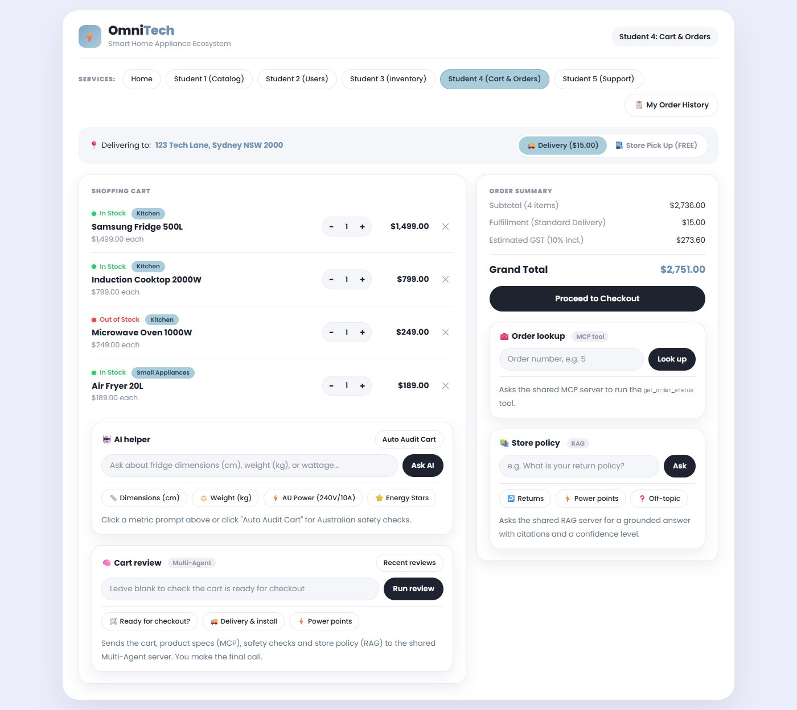

## 05-multi-agent-review
Run review: evidence sent (cart, specs via MCP, safety checks, RAG), then Planner, Worker and Reviewer output

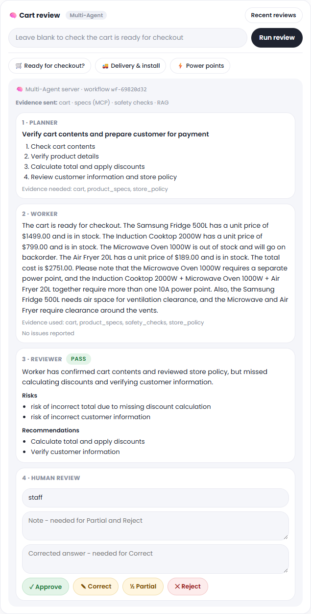

## 06-human-review-note-required
Human review: Partial without a note is refused and the form stays

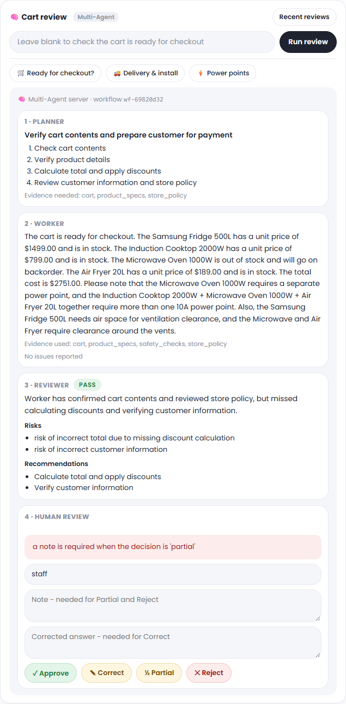

## 07-human-review-partial
Human review saved: workflow wf-69820d32 partially accepted with a note

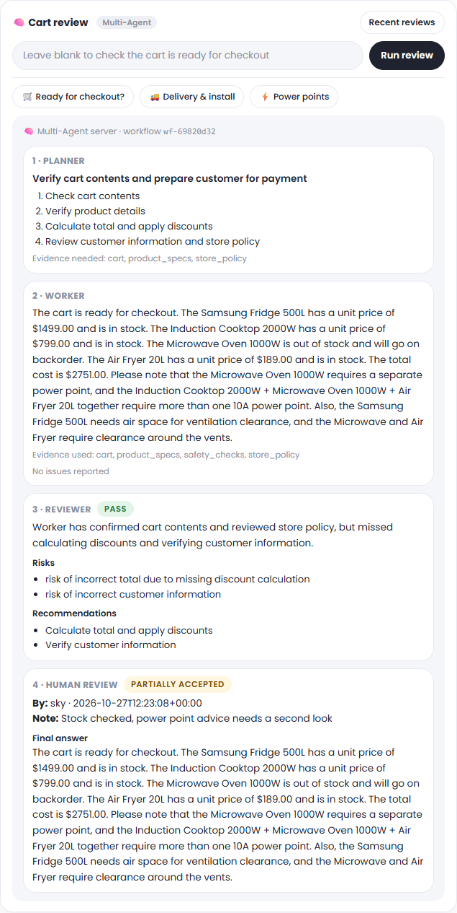

## 08-review-history
Recent reviews: workflow history from the shared Multi-Agent server

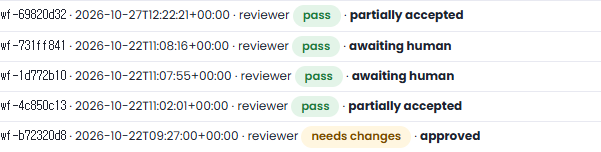

## 09-terminal-cli-list
Terminal: workflow history with cli.py list

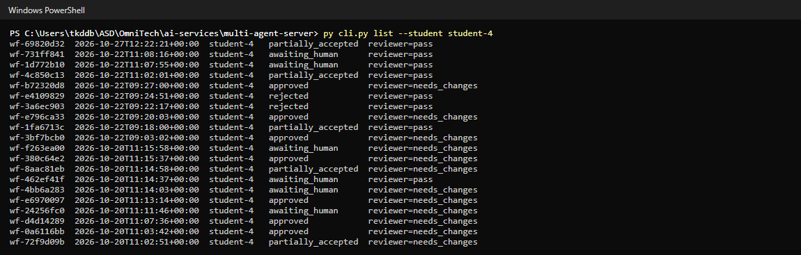

## 10-terminal-cli-show-audit
Terminal: cli.py show wf-69820d32 - Planner, Worker, Reviewer, human decision and the audit log

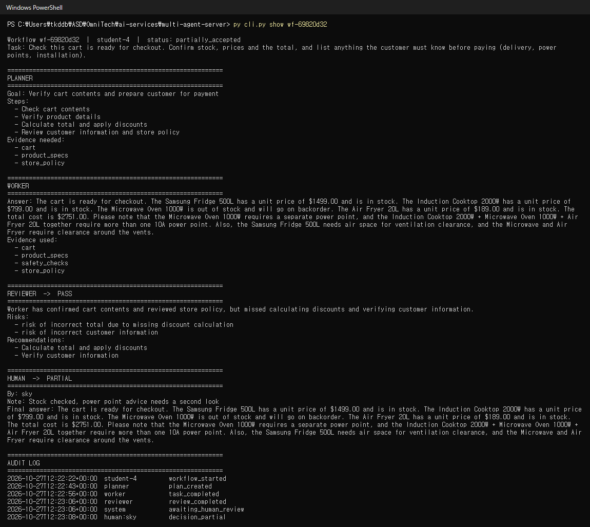

## 11-terminal-multi-agent-tests
Multi-Agent server and shared agentic loop tests

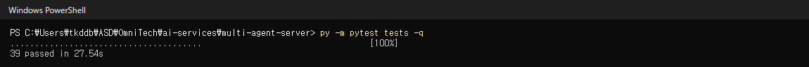

## 12-terminal-endpoint-tests
Post-commit endpoint tests (create_order, update_order) against the running service

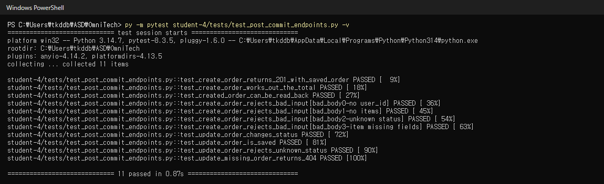

## 13-terminal-student4-tests
Student 4 test suite (agent, MCP, RAG, Multi-Agent card, AI-off, endpoints, live API)

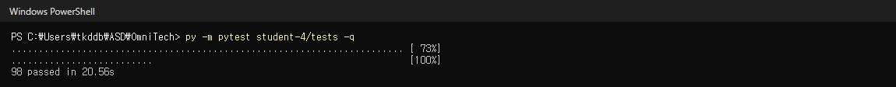

## 14-terminal-security-scan
Pre-commit security scan for student-4: Ruff security rules, detect-secrets, pip-audit

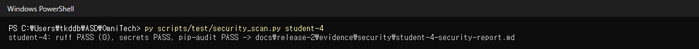

## 15-offline-ai-helper
AI servers stopped: AI helper shows the facts and safety checks from the database

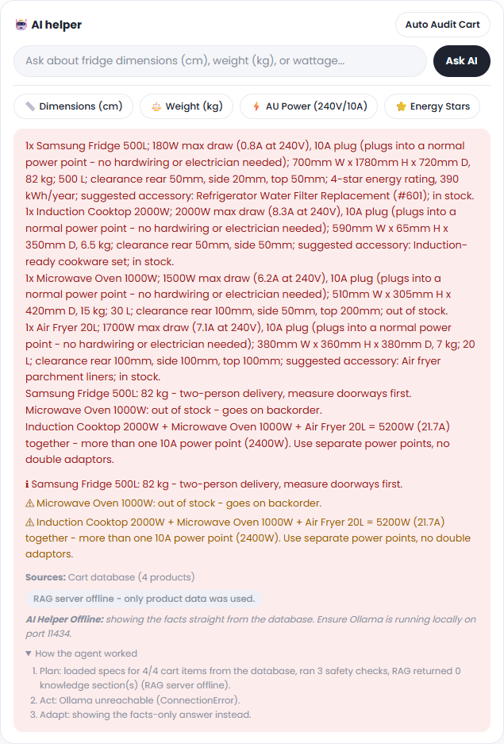

## 16-offline-ai-cards
AI servers stopped: MCP, RAG and Cart review each report their server offline

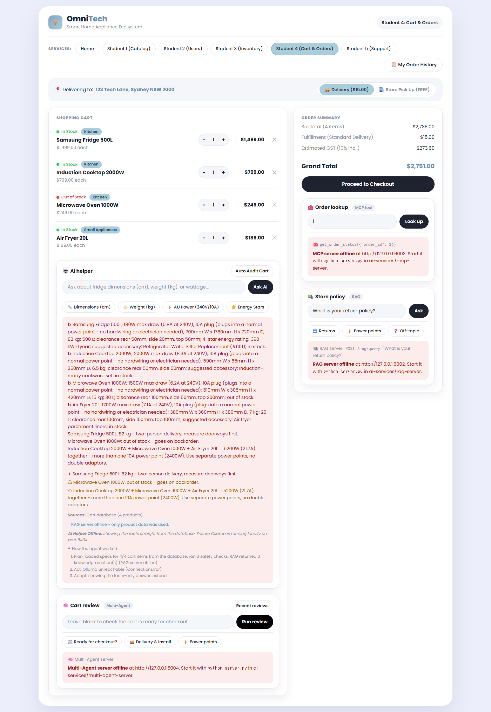

## 17-offline-checkout-still-works
AI servers stopped: checkout still saves a real order (#60)

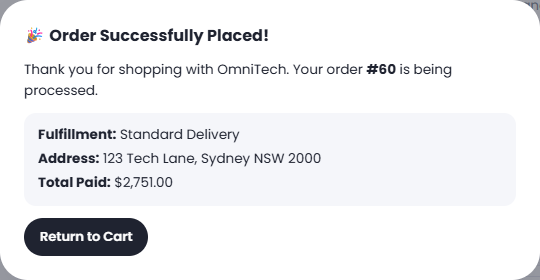

## 18-app-health-ai-off
Cloud mode (AI_ENABLED=false): every AI switch reports false

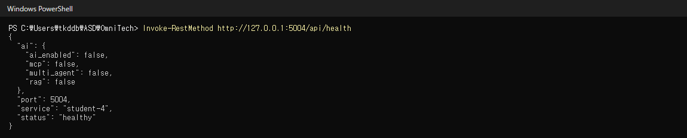

## 19-ai-off-cards
Cloud mode: each AI card says it is turned off in this deployment, instantly

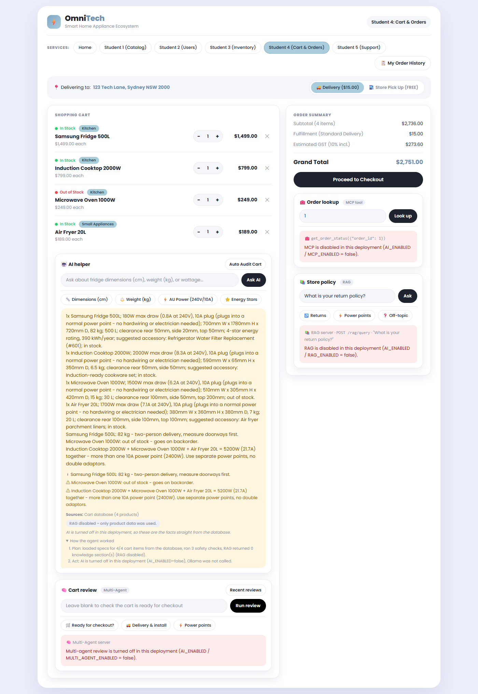

## 20-ai-off-order-crud
Cloud mode: checkout (#61) and order history (update / delete) still work

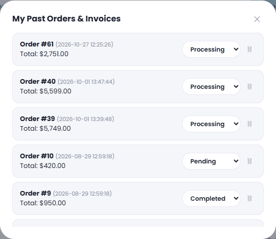
